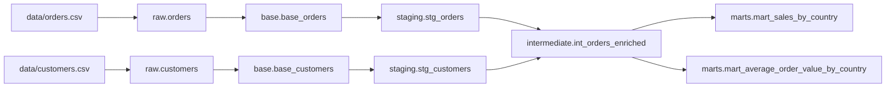

# dbt + GitHub Copilot + MCP demo

This document is the complete, self-guided version of the live demonstration. It explains the project, the data flow, the commands used during the demo, the generated dbt metadata, and the connection between dbt and an AI assistant through MCP.

## 1. Demo in one sentence

The project transforms two local CSV files into tested DuckDB tables and shows how GitHub Copilot can use dbt metadata and MCP tools to explain lineage and help design a new analytical model.

The central question is:

> How much have we sold by country, and where does that number come from?

## 2. What the demo demonstrates

The demo has two related goals:

1. Build a small but realistic dbt project with sources, reusable models, tests, documentation, and lineage.
2. Give an AI assistant access to the project context through the official `dbt-mcp` server so it can inspect dependencies and support analytical development.

The example is intentionally local and reproducible:

- The input is two fictional CSV files.
- DuckDB is the local analytical database.
- dbt Core runs the transformations and tests.
- dbt Docs visualizes the generated metadata.
- The official `dbt-mcp` package exposes local dbt tools to an MCP client.
- A dbt Platform account, Docker, and a cloud data warehouse are not required.

## 3. The pipeline

The project has a source layer and four transformation layers. Sources are declared in dbt, while the four layers are materialized as tables in `demo.duckdb`.



### Layer responsibilities

| Layer | Responsibility | Models or objects |
| --- | --- | --- |
| Source | Declare the original inputs and their metadata. | `raw.orders`, `raw.customers` |
| Base | Read the sources and apply technical type conversions. | `base_orders`, `base_customers` |
| Staging | Standardize names and values for downstream models. | `stg_orders`, `stg_customers` |
| Intermediate | Combine related entities and prepare a business-level row. | `int_orders_enriched` |
| Marts | Publish datasets for analytical consumption. | `mart_sales_by_country`, `mart_average_order_value_by_country` |

Each layer has one main responsibility. That makes it easier to understand where a rule is applied, reuse an intermediate result, and assess the impact of a change.

## 4. Repository map

The most relevant files are:

- [`data/customers.csv`](data/customers.csv) and [`data/orders.csv`](data/orders.csv): fictional inputs.
- [`models/base/_sources.yml`](models/base/_sources.yml): source definitions.
- [`models/base/`](models/base/): type preparation and source configuration.
- [`models/staging/`](models/staging/): normalization models.
- [`models/intermediate/int_orders_enriched.sql`](models/intermediate/int_orders_enriched.sql): order-to-country join.
- [`models/marts/`](models/marts/): analytical marts.
- [`models/_models.yml`](models/_models.yml): model descriptions and column tests.
- [`tests/`](tests/): independent business assertions.
- [`demo.py`](demo.py): portable command-line entry point.
- [`dbt_project.yml`](dbt_project.yml) and [`profiles.yml`](profiles.yml): dbt and DuckDB configuration.
- [`requirements.txt`](requirements.txt) and [`requirements-mcp.txt`](requirements-mcp.txt): Python dependencies.
- [`.vscode/mcp.json`](.vscode/mcp.json): VS Code MCP server configuration.
- `target/`: generated dbt metadata and the dbt Docs site.

This document is intended to stand on its own; the repository also includes a short [social post](SOCIAL_POST.md) for sharing the demo.

## 5. Input data and business rules

### Input files

`data/customers.csv` contains five customers and their countries. Some country values deliberately demonstrate the cleaning rule: for example, ` es` and ` fr` are not already in the final format.

`data/orders.csv` contains ten orders with these statuses:

- `completed`
- `cancelled`
- `pending`
- one uppercase `COMPLETED` value to demonstrate case normalization

All amounts are in EUR. No currency conversion is performed.

### Source definitions

The source definitions in [`models/base/_sources.yml`](models/base/_sources.yml) use DuckDB's `read_csv_auto` to read the CSV files directly. The source path is built from the `DEMO_ROOT` environment variable, which is set by `demo.py`.

There is no `dbt seed` step and no separate raw table-loading job. In dbt Docs, the inputs appear as the sources `raw.customers` and `raw.orders`.

### Transformations

1. [`base_customers.sql`](models/base/base_customers.sql) casts customer fields to explicit types.
2. [`base_orders.sql`](models/base/base_orders.sql) casts identifiers, dates, status, and amounts to explicit types. It renames `status` to `order_status` and `amount` to `order_amount`.
3. [`stg_customers.sql`](models/staging/stg_customers.sql) trims customer names and normalizes country codes with `upper(trim(country))`.
4. [`stg_orders.sql`](models/staging/stg_orders.sql) normalizes statuses with `lower(trim(order_status))`.
5. [`int_orders_enriched.sql`](models/intermediate/int_orders_enriched.sql) left joins each order to its customer's country. It keeps one row per order and retains all statuses.
6. [`mart_sales_by_country.sql`](models/marts/mart_sales_by_country.sql) keeps only rows where `order_status = 'completed'`, then sums the order amount and counts orders by country.

The completed-order rule is applied in the mart, not in the intermediate model. This means the intermediate table remains useful for other analyses that need pending or cancelled orders.

## 6. Expected sales result

Run the demo and the final mart should contain:

| country | total_sales (EUR) | order_count |
| --- | ---: | ---: |
| DE | 100.00 | 2 |
| ES | 350.00 | 3 |
| FR | 150.00 | 2 |

The total is **600.00 EUR across 7 completed orders**. The three cancelled or pending orders remain visible in `intermediate.int_orders_enriched` but are excluded from the sales mart.

The calculation can be followed directly in the intermediate data:

- DE: 85.50 + 14.50 = 100.00
- ES: 120.00 + 200.00 + 30.00 = 350.00
- FR: 60.00 + 90.00 = 150.00

## 7. Setup

Run the commands from the folder containing `dbt_project.yml`.

### Requirements

- Python 3.12
- Internet access for the initial package installation
- A client that supports MCP if you want to run the AI part of the demo

Python 3.14 is not the tested runtime for this dependency combination. On macOS, Python 3.12 can be installed with Homebrew:

```bash
brew install python@3.12
```

### Install the environment

macOS or Linux:

```bash
python3.12 -m venv .venv
.venv/bin/python -m pip install -r requirements.txt -r requirements-mcp.txt
.venv/bin/python -m pip check
```

Windows PowerShell:

```powershell
py -3.12 -m venv .venv
.\.venv\Scripts\python.exe -m pip install -r requirements.txt -r requirements-mcp.txt
.\.venv\Scripts\python.exe -m pip check
```

The virtual environment is machine-specific. Recreate it after moving the project to another computer; do not copy `.venv` between machines.

## 8. Run the dbt demo

The portable launcher is [`demo.py`](demo.py). It sets the project root, profile location, and CSV location automatically, so the commands do not depend on a global dbt configuration.

### Check the local connection

```bash
.venv/bin/python demo.py doctor
```

This runs `dbt debug` with the local profile.

### Build the sales mart

```bash
.venv/bin/python demo.py build
```

The launcher executes the equivalent of:

```bash
dbt build --select +mart_sales_by_country
```

The leading `+` includes all upstream dependencies. dbt therefore builds the two base models, two staging models, the intermediate model, and the selected sales mart in dependency order. It also runs the tests attached to those nodes and the independent sales business test.

For the current project, the normal build covers 6 models and 21 tests.

### Inspect the tables and result

```bash
.venv/bin/python demo.py tables
```

This prints representative tables and checks the expected sales result. It does not require the standalone DuckDB CLI or DBeaver.

### Print the lineage in the terminal

```bash
.venv/bin/python demo.py lineage
```

This reads `target/manifest.json` and recursively prints each node's `depends_on.nodes` entries, starting at `model.dbt_local_demo.mart_sales_by_country`. It is a useful fallback if the browser is unavailable.

### Generate and serve dbt Docs

```bash
.venv/bin/python demo.py docs
.venv/bin/python demo.py serve
```

Open <http://localhost:8080>. Search for `mart_sales_by_country`, open the model, and expand its ancestors to see both paths back to the CSV sources. Stop the server with Ctrl+C.

The generated files are:

- `target/manifest.json`: project metadata, model definitions, source definitions, and dependency graph.
- `target/catalog.json`: database metadata collected by `dbt docs generate`.
- `target/index.html`: the dbt Docs web application.

The manifest is the structured context used by the demo. It is generated from the dbt project files, so it should be regenerated after model or configuration changes.

## 9. Data-quality tests

Tests are declared in [`models/_models.yml`](models/_models.yml) and in the SQL files under [`tests/`](tests/). The project demonstrates both reusable generic tests and independent business assertions.

The model-level tests check, among other things:

- uniqueness and non-null values for identifiers
- non-null order amounts and countries
- allowed order statuses: `completed`, `cancelled`, and `pending`
- allowed countries: `ES`, `DE`, and `FR`
- every staged order refers to a staged customer

The business test [`assert_sales_expected.sql`](tests/assert_sales_expected.sql) compares the mart with independently specified expected values. It returns a failing row if a country is missing, an unexpected country appears, or the amount or order count changes.

The corresponding average-value assertion is in [`assert_average_order_value_expected.sql`](tests/assert_average_order_value_expected.sql).

This separation matters: schema and relationship tests check structural quality, while the business assertions check whether the published metric still matches the expected business result.

## 10. The average-order-value follow-up

The second use case asks the assistant to inspect the existing project and design an analytical model for average order value by country. The implementation is already included in [`mart_average_order_value_by_country.sql`](models/marts/mart_average_order_value_by_country.sql):

```sql
select
        country,
        cast(avg(order_amount) as decimal(12, 2)) as average_order_value,
        count(*) as order_count
from {{ ref('int_orders_enriched') }}
where order_status = 'completed'
group by country
```

Its expected result is:

| country | average_order_value (EUR) | order_count |
| --- | ---: | ---: |
| DE | 50.00 | 2 |
| ES | 116.67 | 3 |
| FR | 75.00 | 2 |

The default `demo.py build` intentionally selects the sales mart and its ancestors, so it does not build this additional mart. To build the follow-up model directly on macOS or Linux, set the same environment variables as the launcher and select the model:

```bash
DEMO_ROOT="$PWD" DBT_PROFILES_DIR="$PWD" \
    .venv/bin/dbt build --select +mart_average_order_value_by_country
```

In Windows PowerShell:

```powershell
$env:DEMO_ROOT = (Get-Location).Path
$env:DBT_PROFILES_DIR = (Get-Location).Path
.\.venv\Scripts\dbt.exe build --select +mart_average_order_value_by_country
```

The `+` again includes the shared upstream models. Before accepting an AI-generated model, review its grain, filters, references, naming, and tests, then run the selected build.

## 11. MCP integration

### What MCP adds

MCP, the Model Context Protocol, gives an AI assistant a standard way to call external tools. In this demo, the assistant can query local dbt project context and use dbt operations instead of relying only on files manually pasted into a conversation.

The project uses the official `dbt-mcp` package from [`requirements-mcp.txt`](requirements-mcp.txt). The demo uses local development tools; it does not use dbt Platform Discovery or Semantic Layer methods.

### Validate the server

After building the project, run:

```bash
.venv/bin/python scripts/check_mcp.py
```

The check opens a real MCP stdio session, initializes the protocol, lists the available tools, and verifies that the tools needed by the demo are present.

### VS Code configuration

The repository includes [`.vscode/mcp.json`](.vscode/mcp.json):

```json
{
    "servers": {
        "dbt-demo": {
            "type": "stdio",
            "command": "${workspaceFolder}/.venv/bin/python",
            "args": ["${workspaceFolder}/demo.py", "mcp"]
        }
    }
}
```

On Windows, change the command to `${workspaceFolder}/.venv/Scripts/python.exe`.

The launcher starts the `dbt-mcp` executable with these important values:

- `DBT_PROJECT_DIR`: the project folder
- `DBT_PATH`: the dbt executable in the virtual environment
- `DBT_PROFILES_DIR`: the local profile folder
- `DEMO_ROOT`: the folder containing the CSV files
- `DBT_MCP_ENABLE_DBT_CLI=true`: enables the dbt CLI tools used by the demo

The MCP process uses stdout for the protocol. Do not add diagnostic `print` calls to the MCP path; write diagnostics to stderr if needed.

### Other MCP clients

To generate a configuration fragment with absolute paths for clients such as Claude Desktop or Cursor, run:

```bash
.venv/bin/python demo.py mcp-config
```

Add the generated `dbt-demo` entry to the client's existing MCP configuration. Preserve other servers instead of replacing the whole file. Regenerate the configuration after moving the project or recreating the virtual environment.

### Tools used in the demo

The first prompt should lead the assistant to use local tools such as:

- `get_node_details_dev` for the model's description, columns, and metadata
- `get_lineage_dev` for upstream and downstream dependencies
- the dbt `show` tool for a read-only query of a model result

Use the local development tools, not similarly named dbt Platform Discovery tools. The exact tool names exposed by a client can vary slightly by version, so verify them in the MCP tool list before presenting.

## 12. Prepared AI prompts

### Prompt 1: explain lineage

```text
Using the available dbt MCP tools, explore the lineage of the sales-by-country model.
Explain how the data flows from the original sources through each transformation layer to the final mart.
Identify the upstream models and summarize the purpose of each layer.
Present the dependencies as a clear, readable diagram using Mermaid, if supported. Do not modify any files.
```

A good response should identify:

1. `raw.orders` and `raw.customers` as the original sources.
2. The type preparation, normalization, customer-country join, and completed-order aggregation.
3. `marts.mart_sales_by_country` as the final one-row-per-country result.

The response can be checked against the dbt Docs graph, `demo.py lineage`, the SQL files, and `target/manifest.json`.

### Prompt 2: develop the follow-up model

```text
Using the available dbt MCP tools, inspect the existing project and identify the models that can be reused to create an analytical model showing average order value by country.
Explain which models you would use and where the new model should fit into the existing pipeline.
Then propose the SQL implementation and appropriate data quality tests, following the project's conventions.
If your setup supports code generation and file modifications reliably, you can let Copilot implement the model. Otherwise, showing the proposed SQL is sufficient to demonstrate the idea.
```

The assistant should recognize that `int_orders_enriched` already contains one order and its normalized customer country. It can therefore reuse that model and add a mart-level aggregation with the same completed-order rule as the sales mart.

For a safe demonstration, ask for a proposal first, review the SQL and tests, and only then allow a file change. AI-generated code still requires developer review and a successful dbt build.

## 13. Suggested replay of the live demo

1. Introduce the business question: trace a sales number back to its original data and rules.
2. Show the repository tree and explain the source, base, staging, intermediate, and marts layers.
3. Run `demo.py build` and explain dependency order and data-quality tests.
4. Run `demo.py tables` and compare the result with the expected sales table.
5. Open dbt Docs at <http://localhost:8080> and expand the ancestors of `mart_sales_by_country`.
6. Open `target/manifest.json` and point out the model's `depends_on.nodes` metadata.
7. Ask the first MCP prompt and show at least one tool call and its response.
8. Ask the second prompt to demonstrate reuse and analytical model development.
9. Close with the main lesson: the assistant becomes more useful when it can access the project's actual metadata and tools.

If the browser or AI client is unavailable, the terminal lineage command and the manifest provide a faithful fallback for the first half of the demo.

## 14. Troubleshooting

| Symptom | Resolution |
| --- | --- |
| dbt dependency errors mention Python 3.14 | Recreate `.venv` with Python 3.12 and reinstall both requirements files. |
| `DEMO_ROOT` is missing | Run dbt through `demo.py`, or set `DEMO_ROOT` and `DBT_PROFILES_DIR` as shown in the average-value command. |
| CSV files cannot be found after moving the folder | Run `demo.py build` and `demo.py docs` from the new copy so paths and generated metadata are refreshed. |
| DuckDB reports a lock | Close DBeaver and other DuckDB connections, then run dbt commands sequentially. |
| Docs does not show a new model | Run a build or parse, regenerate Docs, and reconnect the MCP client. |
| MCP cannot start the executable | Regenerate the client configuration with `demo.py mcp-config` and verify that the path points to the current `.venv`. |
| A remote AI client cannot connect | Confirm that the client has network access. The local dbt workflow itself does not require cloud access after installation. |

## 15. Scope and limitations

- The data is fictional and intentionally small; it demonstrates the workflow, not production-scale performance.
- The lineage shown here is model and source lineage. It is not column-level lineage.
- The source CSVs are read directly by DuckDB; there is no ingestion, orchestration, or cloud deployment component.
- The generated `target/` directory can be regenerated and is not required to share the source project.
- `demo.py build` selects the sales mart by design. The average-value model is a separate follow-up example.
- MCP gives the assistant access to tools and context, but it does not replace code review, test review, or business validation.

## 16. Related documents

- [`README.md`](README.md): short project overview and daily commands.
- [`SOCIAL_POST.md`](SOCIAL_POST.md): a concise summary of the demo for sharing.
- [`SETUP_LOCAL_IA.md`](SETUP_LOCAL_IA.md): setup instructions for configuring the project on another machine.
- [`MCP_EN.md`](MCP_EN.md): focused MCP setup and prompt reference.